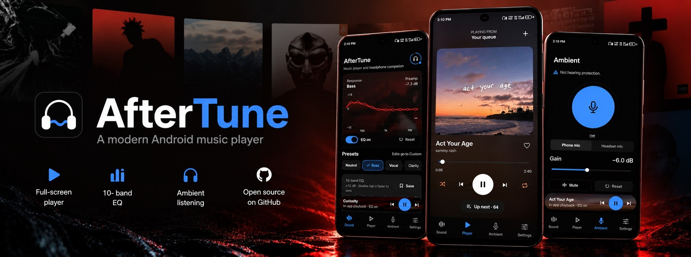
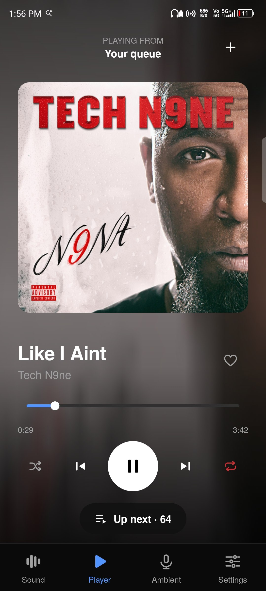
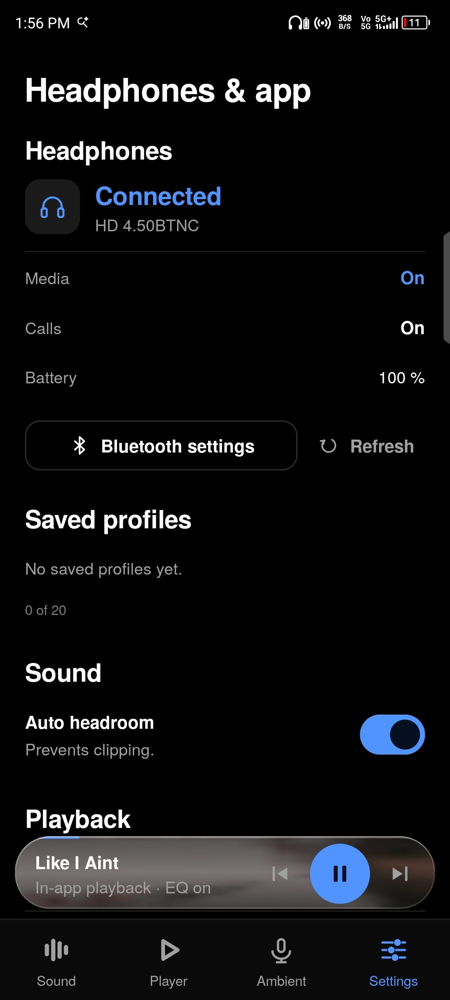

<p align="center">
  
</p>

## AfterTune

A music player with a real equalizer, for Android.

Most phones have no proper EQ, and the ones that do apply it in odd places. AfterTune is a 10-band equalizer and a player built around it: the EQ runs on everything the app plays, and can optionally follow other apps too. It also shows what's playing in other apps, suggests songs from what you listen to, and keeps a status page for your Bluetooth headphones.

<p align="center">
  
  
  
</p>

## What it does

**10-band EQ.** Biquad filters (RBJ cookbook) running inside the Media3 audio pipeline. A live response curve you can drag, presets (Neutral, Bass, Vocal, Clarity, Custom), saved profiles, a preamp, and optional auto headroom that lowers the level so boosts don't clip.

**Player.** Add files or a whole folder. Cover art, seek bar, shuffle, repeat and a like button, with a blurred, slowly moving copy of the cover behind it that reacts to the music. The queue opens from the bottom of the page, and a search box finds songs by title, artist or album.

**For you.** Suggestions from your own library, based on what you finish, skip and like. It's a small scoring model that runs on the phone; nothing is uploaded and there's no account.

**Other apps.** When something plays in another app (Spotify, YouTube Music and so on), the mini player and the Player page show its title, artist and progress, and the play, pause, next and previous buttons control it. The cover moves gently behind the page. That motion is not synced to the audio, because Android doesn't let an app analyse another app's sound. This needs notification access, and it's off until you turn on *Playback from other apps* in Settings.

**System-wide EQ.** Optional. Attaches the EQ to other apps that announce their audio session. See the limits below.

**Ambient listening.** Passes a microphone through to your headphones so you can hear what's around you without taking them off. Gain is limited and defaults to −6 dB on every start. It never records anything.

**Headphones.** Connection state and battery (when the headphones report it) for any Bluetooth headphones, plus a short troubleshooting list in Settings.

## Install

Grab the APK from [Releases](../../releases), open it, and allow "Install unknown apps" for your browser or file manager when Android asks.

**Google Play Protect will flag the app, and you'll need to turn it off to install.** The app can ask for notification access (only if you enable *Playback from other apps*), and it isn't distributed through the Play Store, so Play Protect treats it as a risk. Nothing is being hidden: the source is in this repo and the permissions are listed below. If you'd rather not turn Play Protect off, build it from source instead.

Requires Android 8.0 or newer. Built and tested on my own phone only, so expect rough edges on other devices. Bug reports are welcome.

## Things worth knowing

**By default the EQ applies to audio played inside AfterTune.** Android has no supported way for a normal app to process other apps' audio. The system-wide option uses the documented route: players that announce an audio session (or that offer an "Equalizer" button) can be attached. Whether a given app does that varies by app and device, and the app shows which sessions it actually attached to.

**Ambient mode uses the phone microphone by default,** so it hears the room near the phone, not at your ears. There is also a headset-mic option (Android 12+). It switches the headphones to their call link (mono, call quality), so music degrades or pauses while it's on. Both modes have a noticeable delay because of Bluetooth, so don't expect real-time hearing. It is not hearing protection.

**Song names come from the file.** Files named like `smack-that` show as "Smack That". Artist and album come from the file's tags when it has them, and search and suggestions use the same tags.

## Permissions

| Permission | Why |
|---|---|
| Bluetooth connect | Read connection state and battery of paired headphones. No scanning. |
| Microphone | Ambient listening only. Audio is played back live and never stored. |
| Notifications / foreground service | Keep playback and ambient mode alive with the screen off. |
| Notification access (optional) | Only if you turn on *Playback from other apps*, to read the title, progress and cover of the active media session and to send it play, pause and skip. |
| Modify audio settings | Attach audio effects. |

No account, no analytics, no network access.

## Build from source

Needs JDK 17 and the Android SDK.

```sh
./gradlew testDebugUnitTest
./gradlew assembleDebug
```

The APK lands in `app/build/outputs/apk/debug/`. The included GitHub Actions workflow does the same and uploads the APK as an artifact.

## Stack

Kotlin, Jetpack Compose (Material 3), AndroidX Media3, `AudioRecord`/`AudioTrack` for the ambient path, Storage Access Framework for folders. minSdk 26, target 35. Package: `dev.aftertune`.

The UI uses TeX Gyre Heros, under its own license (see `docs/TEXGYREHEROS_LICENSE.txt`).

## License

[MIT](LICENSE). Free to use, modify and share, as long as the copyright notice stays.

---

Built by [Sutikshan Mishra](https://github.com/Sutikshan-Mishra).
