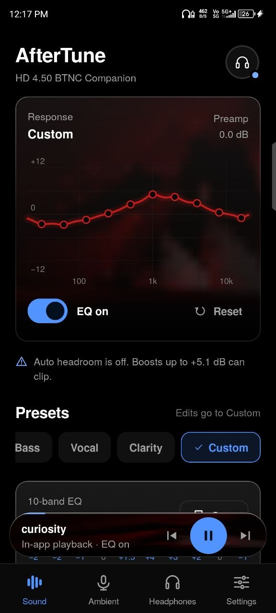
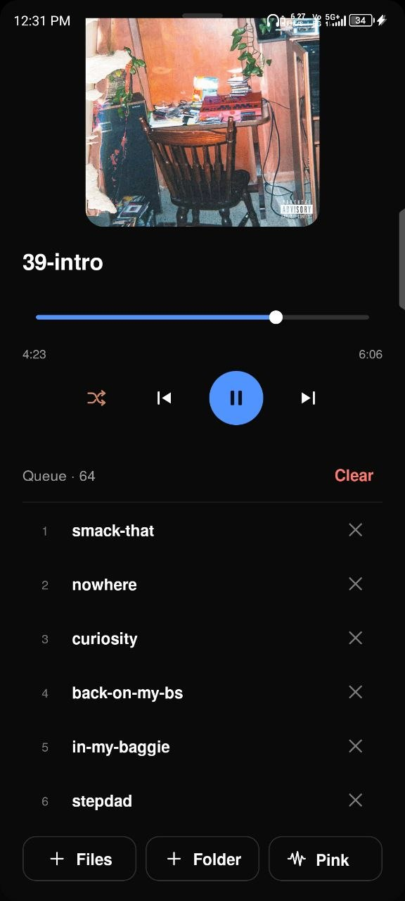
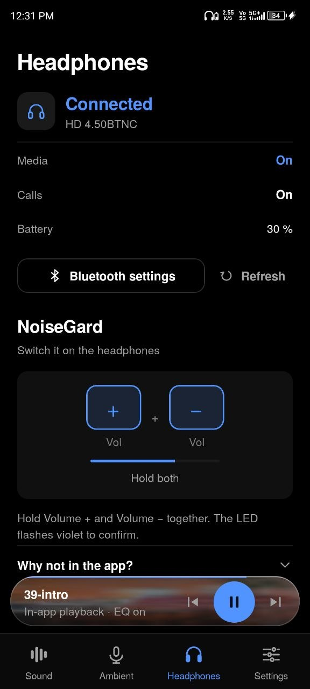

# AfterTune

An EQ companion app for the Sennheiser HD 4.50 BTNC, for Android.

The HD 4.50 BTNC has no companion app, and Sennheiser's Smart Control doesn't support it. AfterTune is what I wanted to exist: a real 10-band equalizer, a small built-in player to run it on, an ambient mode, and a status page for the headphones.

<p align="center">
  
  
  
</p>

> Unofficial. Not affiliated with or endorsed by Sennheiser.

## What it does

**10-band EQ.** Biquad filters (RBJ cookbook) running inside the Media3 audio pipeline, so the EQ is applied to the audio the app plays. You get a live response curve you can drag, presets (Bass, Vocal, Clarity, Custom), saved profiles, a preamp, and optional auto headroom that lowers the level so boosts don't clip.

**Built-in player.** Add files or a whole folder, shuffle, repeat, reorder from the queue. The cover art tints the EQ curve and the queue sheet.

**Ambient listening.** Passes the phone mic through to the headphones so you can hear what's around you without taking them off. Gain is limited and defaults to −6 dB on every start. It never records anything.

**Headphone status.** Connection state, battery when the headset reports it, and a shortcut for NoiseGard.

**Optional extras, both off by default**
- *System-wide EQ (experimental).* Attaches the EQ to other apps that announce their audio session. See the limits below.
- *Artwork from other apps.* Shows the cover from whatever is playing elsewhere behind the EQ card. Needs notification access.

## Install

Current version: **v1.0.0**. Grab the APK from [Releases](../../releases), open it, and allow "Install unknown apps" for your browser or file manager when Android asks.

**Google Play Protect will flag the app, and you'll need to turn it off to install.** The app can ask for notification access (only if you enable *Artwork from other apps*), and it isn't distributed through the Play Store, so Play Protect treats it as a risk. Nothing is being hidden: the source is in this repo and the permissions are listed below. If you'd rather not turn Play Protect off, build it from source instead.

Requires Android 8.0 or newer. Built and tested on my own phone only, so expect rough edges on other devices. Bug reports are welcome.

## Things worth knowing

**NoiseGard can't be controlled from the app.** Sennheiser publishes no protocol for it and the headset only exposes standard Bluetooth audio profiles. To toggle it, press and hold Volume + and Volume − together on the headphones (the LED flashes violet three times). AfterTune shows this as a reminder rather than pretending to switch it.

**By default the EQ applies to audio played inside AfterTune.** Android has no supported way for a normal app to process other apps' audio. The system-wide option uses the documented route: players that announce an audio session (or that offer an "Equalizer" button) can be attached. It works on my phone, but whether a given app does that varies by app and device, and the app shows which sessions it actually attached to.

**Ambient mode uses the phone microphone by default,** so it hears the room near the phone, not at your ears. There is also a headset-mic option (Android 12+), which on my HD 4.50 BTNC works better than the phone mic. It switches the headset to its call link (mono, call quality), so music degrades or pauses while it's on. Both modes have a noticeable delay because of Bluetooth, so don't expect real-time hearing. It is not hearing protection.

## Permissions

| Permission | Why |
|---|---|
| Bluetooth connect | Read connection state and battery of the paired headphones. No scanning. |
| Microphone | Ambient listening only. Audio is played back live and never stored. |
| Notifications / foreground service | Keep playback and ambient mode alive with the screen off. |
| Notification access (optional) | Only if you turn on *Artwork from other apps*, to read the cover of the active media session. |
| Modify audio settings | Attach audio effects. |

No account, no analytics, no network access.

## Build from source

Needs JDK 17 and the Android SDK.

```sh
./gradlew testDebugUnitTest
./gradlew assembleDebug
```

The APK lands in `app/build/outputs/apk/debug/`. The included GitHub Actions workflow does the same and uploads the APK as an artifact.

## Stack

Kotlin, Jetpack Compose (Material 3), AndroidX Media3, `AudioRecord`/`AudioTrack` for the ambient path, Storage Access Framework for folders. minSdk 26, target 35. Package: `dev.hd450btnc.companion`.


## License

[MIT](LICENSE). Free to use, modify and share, as long as the copyright notice stays.

---

Built by [Sutikshan Mishra](https://github.com/Sutikshan-Mishra).
